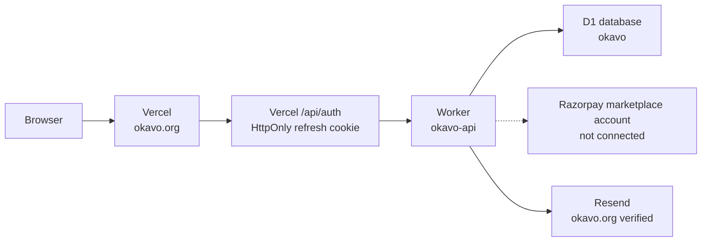

# Okavo — architecture guide

Written 12 October 2026 so a different AI on a different computer can work without this chat.

## Backend as of 13 October 2026

Production no longer uses Supabase. The project `fzgnzaflvbimbiseqnrz` was deleted. Accounts, marketplace rows, and payment records live in the existing Cloudflare D1 database `okavo` (`3d3afb8e-1749-4c70-8001-e115504e3b03`) on account `ec00d4a6131c20118d82605d6b969c8e`. The API is the Worker `okavo-api` at `https://okavo-api.fkhambaty.workers.dev` (`cloudflare/worker`). The browser calls that Worker with a short-lived bearer token. The Vercel `/api/auth` routes still own the HttpOnly refresh cookie and never put the session in `localStorage`.

Signup does not create a session until a 6-digit email code is confirmed. Password reset uses the same kind of code. Sending those codes requires the `okavo.org` domain to be verified in Resend. On 13 October 2026 that domain finished verification (DKIM TXT, SPF MX, SPF TXT, and the tracking CNAME were all verified). A real signup message to `delivered@resend.dev` was accepted and Resend reported it delivered. A profile inserted directly in D1 with `email_verified_at` set can still log in without waiting for the code.

Okavo payments are disabled as of 13 October 2026. Razorpay rejected `okavo.org` on the FKTech EdTech merchant because Okavo is a marketplace. The Worker has an empty `RAZORPAY_KEY_ID` and `RAZORPAY_PAYMENTS_ENABLED = "false"`, so it refuses checkout before contacting Razorpay. Re-enable payments only after a separate marketplace merchant account approves `okavo.org`, then install that account's key id, key secret, and product-specific webhook secret. The Worker still owns amounts and only marks a payment paid after signature and provider checks. The dummy login (`dummy` / `dummy`) stays in the browser, uses fixture rows, and never calls the Worker or Razorpay.



The dashed Razorpay line is intentional. Checkout is switched off until a separate marketplace merchant approves `okavo.org`. The access token stays in memory. It is not stored in `localStorage`.

GoDaddy reported on 14 October 2026 that `okavo.org` expires **31 July 2027** and automatic renewal is **off**. The site does not survive that date unless the owner renews it or explicitly enables auto-renew in GoDaddy. This is an account/billing action, not a code deployment.

### Shared D1 quota dependency

All D1 databases in Cloudflare account `ec00d4a6131c20118d82605d6b969c8e` share the free-tier daily limits. On 14 October 2026 an unrelated `customjobseek` database used 167,866 row writes and exhausted the account's 100,000 free daily row-write allowance; Okavo itself recorded no writes in that usage window. Account and marketplace writes then failed until Cloudflare's 00:00 UTC reset. The Worker detects this exact condition and returns a truthful retryable HTTP 503 instead of a generic 500; it cannot restore writes.

This can recur every day while that workload remains in the same free account. The durable remedies are to upgrade the Cloudflare account to Workers Paid or isolate/stop the unrelated workload. Do not modify `customjobseek` from this repository. Cloudflare documents the shared daily allowance and reset at https://developers.cloudflare.com/d1/platform/pricing/ and https://developers.cloudflare.com/d1/platform/limits/.

The owner explicitly declined a billing-plan change on 14 October 2026. Therefore daily write outages remain an accepted external risk until that decision changes.

These routes stay unimplemented and return an error instead of invented data:

- Requirement-assist language models. The page keeps the local heuristic only.
- Stripe checkout and the old Razorpay reconcile cron.
- Passwordless operator tokens. `scripts/okavo.mjs` database commands no longer talk to Supabase.

Private files, build exams, and owner admin promotion are live. Checkout is not live. See the sections below.

Analytics collection returns HTTP 503 with `{ error: "analytics_misconfigured", missing: [...] }` when `OKAVO_API_URL` or `ANALYTICS_INGEST_SECRET` is absent. It does not return a silent 204 for that case. The response names the missing settings and does not include the secret. The Worker answers 503 when its own ingest secret is missing and 401 when the header does not match.

R2 is not enabled (API error 10042). `cloudflare/d1/0003_storage_audit.sql` adds storage columns and a deletion audit. Uploads stay in D1 until a `FILES` binding exists. Health reports `storage: "d1"` and `r2Enabled: false` until then.

`CHECKOUT_MODE` remains `hosted` for the future marketplace merchant account. `GET /v1/payments/quote` returns the server amount with `charge: false` and does not create a Razorpay order. Pending-payment reconciliation is report-only unless `ALLOW_PAYMENT_RECONCILIATION` is `"true"`.

Founder requirements are not seeded by a script. `docs/FOUNDER_SEEDING.md` is the hand workflow. Counts of zero are the honest state.

## Private files

Cloudflare R2 is not enabled on this account (API error 10042). Identity documents and milestone payment proofs are stored in D1, not in a public bucket.

- Tables: `files` and `file_chunks` in `cloudflare/d1/0002_files_exams_checkout.sql`. Each chunk is about 512 KB of base64.
- Limit: 5 MB. Types: JPEG, PNG, WebP, PDF. The Worker checks the file header, not only the browser’s MIME label. Selfies cannot be PDFs.
- Download: `GET /v1/files/:id` with the caller’s bearer token. The owner can open their own file. An admin can open any file. For a payment proof, the other party on that contract can open it too. There is no public URL.
- Identity retention: 90 days after an admin approves or rejects, the Worker deletes the chunks and replaces the path with `[purged]`. The operations health check runs that purge. Payment proofs are kept with the payment record.

## Build exams

`POST /v1/exams/start` assigns the least-used brief from `exam_briefs`, opens a 5-hour window, and caps starts at 10 per UTC day. Submit takes a public GitHub or GitLab URL and a public HTTPS live URL. `POST /v1/exams/:id/score` runs the local heuristic (URL shape, reachability, duplicate repository). It does not call an LLM. A score of 70 or higher can auto-approve after 48 hours unless an admin paused auto-approval or placed a hold. Admin review is `/app/exams`. Bidding is refused until `interview_status` is `approved`.

Exam starts are on. An admin can pause new starts or auto-approval from that page.

## Admin promotion

`fakhruddinkhambaty@gmail.com` and `fktiindia@gmail.com` receive `role = admin` when they sign up, when they verify the email code, and when they log in. The Worker does not create those accounts or invent a password. Extra addresses can be added with the `ADMIN_EMAILS` Worker variable; the two owner addresses stay included. The admin queue is `/app/verifications` (identity), `/app/exams`, and the contract page for payment proofs.

## Hosted checkout

Checkout is currently disabled. After a separate marketplace Razorpay account approves `okavo.org`, `CHECKOUT_MODE` should initially remain `hosted`. In that mode the Worker creates a Razorpay Payment Link (`POST /v1/payment_links`) and the browser goes to Razorpay's `short_url`. Notes are `{ payment_id, product: "okavo" }`. Notify is off. The callback is `https://okavo.org/app/payments/return`.

On return, the page posts the query string to `POST /v1/payments/razorpay/link-return`. The Worker checks `HMAC_SHA256(key_secret, payment_link_id|payment_link_reference_id|payment_link_status|razorpay_payment_id)`, fetches the payment, and settles only when the amount and currency match. The webhook event `payment_link.paid` is a backup, as is `payment.captured`.

If `CHECKOUT_MODE` is `modal`, Standard Checkout opens first. A website/domain-mismatch `payment.failed`, or a modal that never renders, falls back to the same Payment Link.

To restore checkout after the marketplace account is approved, install that account's Worker secrets, set its public key id, change `RAZORPAY_PAYMENTS_ENABLED` to `"true"`, and redeploy. To use the modal after Razorpay also approves Standard Checkout for okavo.org, change the checkout mode:

```bash
# in cloudflare/worker/wrangler.toml
CHECKOUT_MODE = "modal"
npx wrangler deploy
```

Leave it `hosted` until that approval is confirmed. Dummy login (`dummy` / `dummy`) still never calls the Worker or Razorpay.

Older sections below that name Supabase describe the system as it was on 12 October 2026.

Read this file, then `AGENTS.md`. `docs/architecture/forma-platform.md` is an older thesis from when the product was called FORMA. The running product is Okavo. Do not rename it back, and do not treat that thesis as the schema.

## What it is

Okavo is a two-sided marketplace. A buyer describes software in plain language, reviews a scope, and signs a lock. Identity-checked developers then bid on that frozen scope. Okavo does not hold the build money. The buyer pays the developer milestone by milestone, outside Okavo, after accepting the work. Okavo's own fees (posting, membership, hire success fee) are collected with Razorpay.

Live brand: **Okavo**. Support: `support@okavo.org`.

It is not FunBerry Kids and it is not Data For Dummies.

## Live addresses

| Surface | Address | Status on 12 Oct 2026 |
|---------|---------|------------------------|
| Website | https://okavo.org | HTTP 200. Marketing pages render after JavaScript loads. A screenshot taken too early shows only "Loading…". |
| www | https://www.okavo.org | Redirects to the apex. DNS is a CNAME to `cname.vercel-dns.com`. |
| Older Vercel URL | https://pro-catalog-nu.vercel.app | Still HTTP 200. Same kind of app. Do not delete it until the domain cutover is confirmed in Vercel. |
| GitHub | https://github.com/fkhambaty/okavo | Source of truth. |

The apex `okavo.org` answers through GoDaddy forwarding addresses (`216.198.79.1`, `64.29.17.1`), not through the Vercel CNAME that `www` uses. Forwarding is the fragile part. GoDaddy API keys are created at https://developer.godaddy.com/keys. Do not invent DNS records.

Vercel project name in `docs/deploy.md`: `pro-catalog`, root directory `apps/catalog`.

## How a request moves

```
Browser (Vite React SPA, apps/catalog)
  → Vercel static hosting, with a rewrite to index.html
  → Vercel /api/auth receptionist (HttpOnly refresh cookie, access token in memory)
  → Supabase project fzgnzaflvbimbiseqnrz
      → Auth
      → Postgres + row-level security
      → Edge functions for Razorpay, exams, signup mail, retention
  → Razorpay (shared FKTech account, via the Worker) for the posting fee, the developer membership, and the hire success fee
```

There is no separate application server. If Supabase is paused, sign-in, bids, and payments stop, even when the marketing HTML still loads.

## Repository map

```
apps/catalog/src          React app. Routes are in src/App.tsx.
apps/catalog/api          Vercel functions (auth receptionist, analytics).
supabase/migrations       Schema, RLS, triggers. 25 migrations in git.
supabase/functions        razorpay-order, razorpay-webhook, razorpay-confirm,
                          razorpay-reconcile, exam-analyze, notify-signup,
                          notify-user, identity-retention-sweep.
                          stripe-checkout and stripe-webhook are not the live path.
scripts/okavo.mjs         Operator console. Reads .okavo-agent (gitignored).
docs/deploy.md            Environments and the deploy steps.
brand/                    Brand assets.
ops/, apps/demo-growth/   Earlier prototype. Not part of the live build.
```

## Routes that matter

Marketing: `/`, `/how-it-works`, `/example`, `/guarantee`, `/security`, `/faq`, `/about`, `/terms`, `/privacy`, `/signin`.

Signed-in workspace, under `/app`: project, contract, contracts, messages, notifications, and role-specific pages (buyer intake and payments, developer bids and earnings and verification, admin review).

Fees and copy that quote money live in `apps/catalog/src/lib/pricing.ts`. Change them there. The browser must not tell the server an amount. A payment is marked paid only by the Worker, after the signature-checked confirm path or the signed webhook (`cloudflare/worker/src/payments.js`, `settlePayment`).

## Data and auth

- Production Supabase ref: `fzgnzaflvbimbiseqnrz`
- API settings: https://supabase.com/dashboard/project/fzgnzaflvbimbiseqnrz/settings/api
- Staging is a different project. Set `SUPABASE_PROJECT_REF` before any seed or smoke test.
- `npm run rls` refuses production. Destructive seeds refuse production unless `OKAVO_ALLOW_PRODUCTION_DESTRUCTIVE=1`.
- The service-role key can read identity documents and payments. It belongs in `.okavo-agent`, never in git or in a chat log.
- Sessions must stay on the Vercel auth receptionist. Do not put the session back in `localStorage`.
- Test login `dummy` / `dummy` opens an isolated buyer demo. The demo marker persists in `sessionStorage` so refreshes stay in the test workspace, while marketplace changes reset with the in-memory fixtures. It never creates a Supabase session, reads live rows, or grants developer/admin access; the workspace must label it `Demo data`.
- Demo posting, hiring, and developer membership actions are simulations and must say `no charge`; they must never call Razorpay. Live authenticated accounts keep the real server-created Razorpay order and signature-confirmation path.
- On 12 Oct 2026 the auth health URL for this project did not return a healthy response. Treat "the site is up" and "the database is up" as two different facts.

Two database rules are the product:

- A buyer posting fee is consumed once, inside Postgres, before a requirement row is inserted.
- A developer cannot bid until `bidding_unlocked_at` is set. The UI disable is not the security check.

## Local run

```bash
npm install
npm run dev          # http://127.0.0.1:5180
cd apps/catalog && npx tsc -b --force
npm run build
```

`npx tsc --noEmit` is the wrong check. This app uses TypeScript project references. Use `tsc -b --force`.

Copy `scripts/env.example` to `.okavo-agent` and `apps/catalog/env.example` to `apps/catalog/.env.local`.

## Design system

The catalog UI is a warm editorial system: paper (`--paper`, `--bg`), ink (`--ink`), and one amber signal (`--accent`). Tokens and primitives live in `apps/catalog/src/index.css`. Shared React pieces are `LoadingState` (route and gate waits), `MarketingLayout` (public chrome), and `AppShell` (signed-in chrome). Sign-in uses `AuthFrame` in `pages/SignIn.tsx`.

Prefer the semantic aliases (`--text`, `--border`, `--focus-ring`, `--on-ink`, `--measure`) over new hex values. Status colours stay honest: green is a lock or a live connection, amber is attention, red is a real failure. Do not add testimonials, counts, logos, escrow, or a delivery guarantee in the visual layer. Motion is short (`--dur`) and turns off under `prefers-reduced-motion`. Prices stay in `apps/catalog/src/lib/pricing.ts`. Security copy stays in the page source and in `apps/catalog/src/content/trust.ts`.

Horizontal clipping lives on `html`, not `body`. A clip or hidden overflow on `body` becomes a scrollport and cuts off the fixed workspace drawer, the marketing menu lock, and the idle dialog. Opening either menu calls `lockPageScroll` (`apps/catalog/src/lib/scrollLock.ts`), which pins the page with `position: fixed` and does not set `overflow` on `body`. Wide tables sit in a sideways-scrolling card with a “Swipe sideways” hint below 1000px. Text inputs are 16px through 1180px wide so iOS does not zoom them. Controls that people tap are at least 44px tall through that same width. Safe-area insets pad the marketing bar, footer, auth frame, workspace drawer, and idle dialog. Landscape phones shorter than 500px tighten the hero and the sign-in frame. The dummy login (`dummy` / `dummy`) stays a buyer labelled `Principal · lifetime` and never starts a charge. The developer fixture session is a different demo role: identity and membership are unfinished so the upload and exam forms can be checked, and its membership button says no charge.

The viewport matrix and how to run it are in `docs/responsive.md`.

## What not to get wrong

- Do not invent testimonials, country counts, or customer logos. A fake "74 countries" claim was removed once already.
- Do not say Okavo holds escrow or guarantees delivery. It does not.
- Fees are shown in USD. Razorpay collects the INR equivalent until a USD processor is live.
- Trademark clearance for the name was still outstanding when this guide was written. Do not claim the name is cleared.

## If this computer is gone

`https://github.com/fkhambaty/okavo` is the copy that matters. It contains this guide, `AGENTS.md`, `docs/deploy.md`, the catalog app, the Worker, and the D1 schema. Vercel rebuilds the website from that repository.

These names are Worker secrets and are not stored in Git: `RESEND_API_KEY`, `RAZORPAY_KEY_SECRET`, `RAZORPAY_WEBHOOK_SECRET`, `ANALYTICS_INGEST_SECRET`, and `OPS_CRON_SECRET`. They remain in Cloudflare even if this laptop is lost. `RAZORPAY_KEY_ID` is blank in `wrangler.toml` on purpose, and `RAZORPAY_PAYMENTS_ENABLED` is `false`. A local copy under `~/.config/fk-products/` is only a convenience and must never be committed. Do not put the old EdTech Razorpay key back into Okavo.

The estate-wide handover (all three products, accounts, DNS, runbooks, history and diagrams) is the private repository https://github.com/fkhambaty/products-handover. Start there on a new computer.
