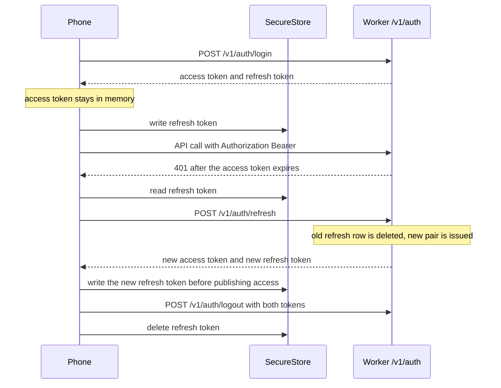
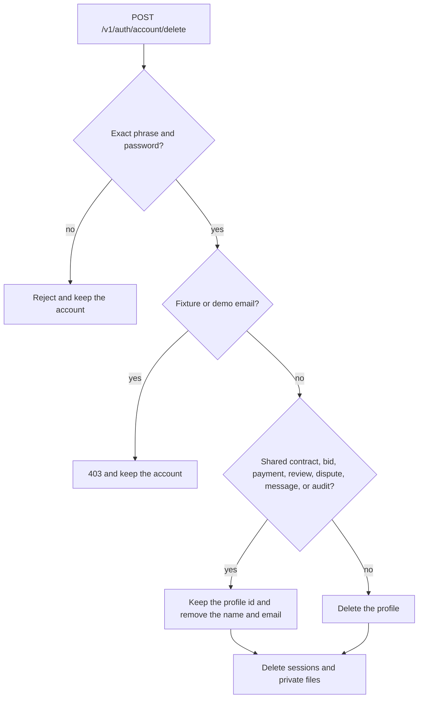
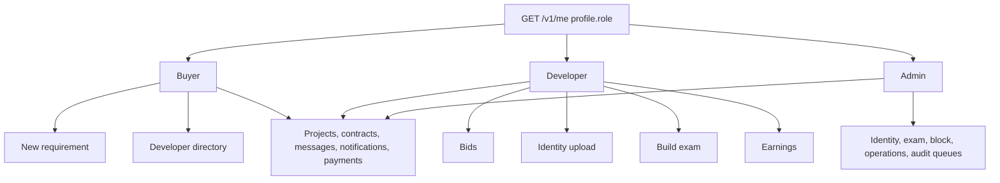
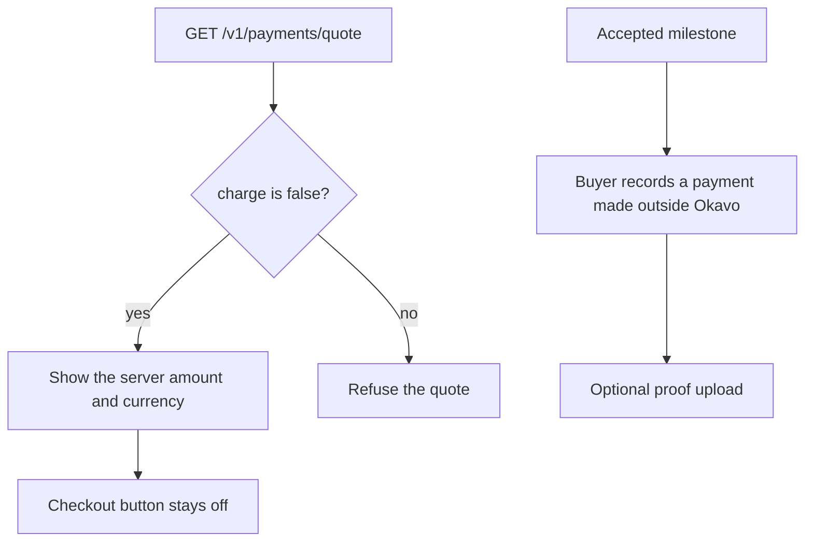

# Okavo mobile architecture

Written 14 October 2026. The running website is still `apps/catalog`. This file describes the iOS and Android app in `apps/mobile`.

## What it is

Okavo on a phone is the same marketplace: a buyer locks a software scope, and an identity-checked developer bids on that scope. Okavo does not hold the build money and does not guarantee delivery. The app does not invent projects, developers, bids, or payments when the Worker returns none.

Bundle id and Android package: `org.okavo.app`. URL scheme: `okavo://`.

## Two ways to sign in

The website keeps the refresh token in an HttpOnly cookie on `okavo.org`. The app cannot use that cookie. It calls the Worker directly. The Worker allows a request that sends no `Origin`. A browser origin outside the website list is still rejected, so Expo web is not a client.

Rules:

- The access token is never written to SecureStore, AsyncStorage, a URL, or a WebView.
- Refresh uses one in-flight request. Two screens cannot rotate the same token twice.
- If the keychain write fails, the new refresh token is held in memory only until the write succeeds. It is not discarded, because the server has already deleted the old one.
- Logout still clears the phone if the network fails, after attempting revocation.
- Signup does not create a session. The app waits for the email code from `POST /v1/auth/verify`.
- Password reset uses `POST /v1/auth/recovery` and `POST /v1/auth/reset`. Reset revokes every session.
- The role used for navigation comes from `GET /v1/me`. The login payload maps an admin to buyer metadata for the website; the app does not trust that field.
- The website demo login (`dummy` / `dummy`) is not in the app.

## Account deletion

The Account screen sends `POST /v1/auth/account/delete` with the current password and the exact phrase `DELETE MY OKAVO ACCOUNT`. A fixture or demo email is refused. Sessions and private files are deleted either way. A profile with no shared marketplace history is deleted. A profile that still has a contract, bid, payment, review, dispute, message, or audit record keeps its id so the other party's rows are not cascaded away, and the name and email are removed.

## Role map

A screen the role cannot open says so. It does not show another role’s data. Project, contract, and message detail routes stay available to every signed-in role; the Worker decides which rows that account can see.

## Files

Identity documents, selfies, and payment proofs are chosen on the device. The app checks the 5 MB limit, the JPEG/PNG/WebP/PDF header, and refuses a PDF selfie before upload. The Worker repeats those checks. A download of `GET /v1/files/:id` sends the bearer token in the header and then hands the file to the system share sheet. There is no public URL.

## Payments

Platform posting, membership, and hire fees are not collected in the app. A requirement can be published only when an unused paid posting fee already exists. Bidding stays locked until `bidding_unlocked_at` is set. Awarding a bid is not offered, because the hire fee cannot be collected.

## WebView and links

The WebView origin list is `https://okavo.org`. Top-level navigation must be one of `/terms`, `/privacy`, `/security`, `/guarantee`, `/how-it-works`, `/faq`, or `/about`. Any other host, `javascript:`, or a link carrying `access_token` or `refresh_token` is blocked.

`okavo://app/...` and `https://okavo.org/app/...` open the matching native screen. `https://okavo.org` universal links are not deployed: there is no Apple App Site Association or Android asset link yet.

## Shared code

`packages/core` has no React and no React Native. The website imports its pricing, guardrails, and terms version from there. Mobile session rotation and the API client live there too and are covered by Node tests.

## Not built

- Remote push. The notification list refreshes when the app becomes active. No APNs or FCM key is configured.
- App Store or Play billing. Do not add a store product until those accounts exist.
- A second dark theme. The app uses the paper, ink, and amber palette.
- Expo web.
